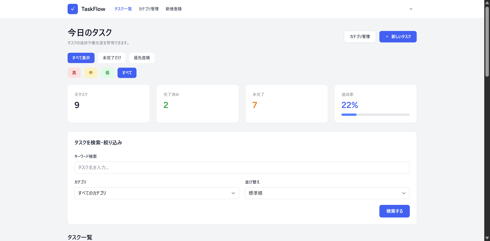
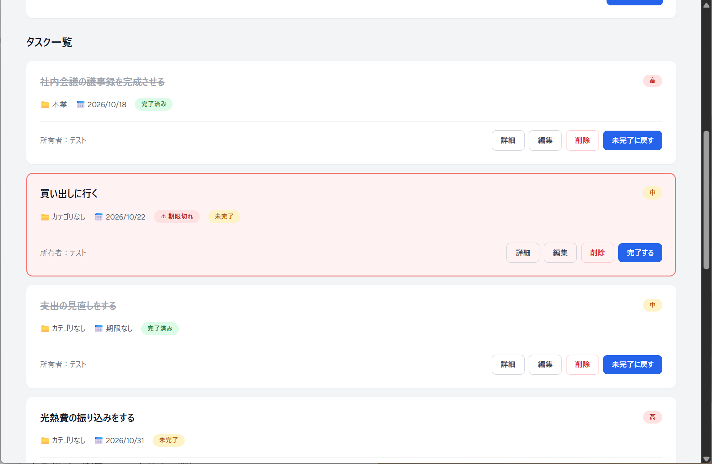
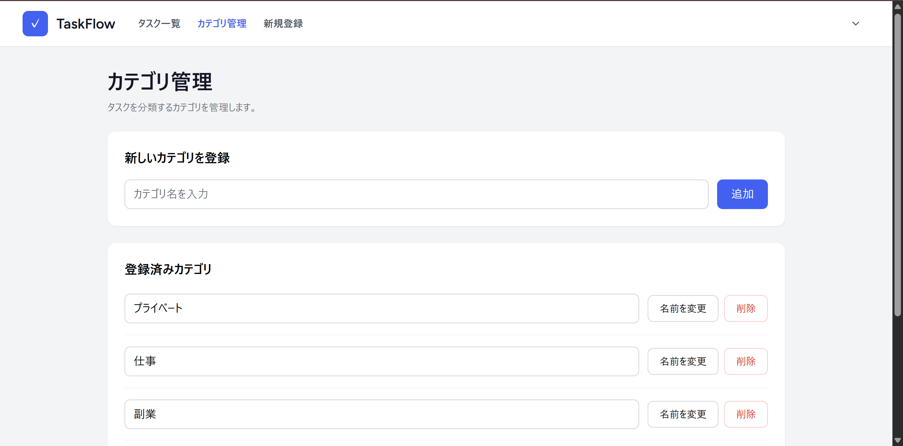

# TaskFlow

Laravelで開発した、個人向けのタスク管理Webアプリケーションです。

タスクの登録・編集・削除に加え、優先度や期限、カテゴリを設定してタスクを整理できます。

検索・絞り込み・並び替え機能を備え、PC・スマートフォンの両方で利用しやすい画面を目指して開発しました。

公開アプリ：[TaskFlow](https://mayu-taskflow.duckdns.org/)

アプリの開発に加え、Oracle Cloud上のLinux環境へのデプロイ、HTTPS公開、OSレベルのバックアップ処理の設定まで取り組みました。

## 主な機能

- **ユーザー認証**：ユーザー登録・ログイン・ログアウト
- **プロフィール管理**：名前・メールアドレス変更、パスワード変更、アカウント削除
- **タスク管理**：登録・一覧表示・詳細表示・編集・削除
- **完了状態の管理**：完了・未完了の切り替え
- **優先度設定**：高・中・低の3段階
- **期限管理**：期限の設定・変更・解除
- **カテゴリ管理**：カテゴリの追加・名前変更・削除
- **検索・絞り込み**：タスク名検索、カテゴリ・優先度による絞り込み、未完了のみの表示
- **並び替え**：新しい順・古い順・優先度順
- **進捗表示**：タスク総数、完了数、未完了数、完了率
- **レスポンシブ対応**：PC・スマートフォンに対応

## スクリーンショット

### タスク一覧・進捗管理



### タスクカード・操作画面



### カテゴリ管理



## 使用技術

| 分類                                 | 技術・構成                                            |
| ------------------------------------ | ----------------------------------------------------- |
| バックエンド                         | PHP / Laravel                                         |
| ローカル開発環境の確認済みバージョン | PHP 8.4.27 / Laravel 12.69.2                          |
| フロントエンド                       | Blade / Tailwind CSS / JavaScript / Vite              |
| 開発用データベース                   | MySQL                                                 |
| 本番用データベース                   | SQLite                                                |
| テスト用データベース                 | SQLite（メモリ内DB）                                  |
| ORM                                  | Laravel Eloquent ORM                                  |
| テスト                               | Laravel Feature Test / PHPUnit                        |
| 公開環境                             | Oracle Cloud / VM.Standard.E2.1.Micro / Linux / HTTPS |
| バックアップ処理                     | Bash / cron / Windows PowerShell / タスクスケジューラ |
| 整合性チェック                       | SHA256                                                |
| バージョン管理                       | Git / GitHub                                          |

PHP・Laravelのバージョンはローカル開発環境で確認した値です。本番環境が同じバージョンであることを示すものではありません。

## 公開・運用

Oracle CloudのLinuxサーバー（VM.Standard.E2.1.Micro）にデプロイし、[HTTPSで公開](https://mayu-taskflow.duckdns.org/)しています。本番環境ではSQLiteを使用しています。

### バックアップの構成

| 処理                               | 使用技術                        | 設定時刻・確認状況                                       |
| ---------------------------------- | ------------------------------- | -------------------------------------------------------- |
| サーバー上のSQLiteバックアップ作成 | Bash / cron                     | 毎日3:00に実行する設定                                   |
| Windowsへのバックアップ取得        | PowerShell / タスクスケジューラ | 毎日8:00に実行する設定。手動テスト成功、定刻実行は未確認 |
| 取得ファイルの整合性チェック       | PowerShell / SHA256             | 取得元と取得後のハッシュ値を比較                         |

時刻は各実行環境のスケジューラ設定に従います。サーバーとWindowsのタイムゾーンが一致しているかは、別途確認が必要です。

これらはBash・cron・PowerShellを使ったOSレベルのバッチ処理です。SHA256の一致は転送前後のファイルの一致を確認するもので、SQLiteの論理的な整合性や復元成功を保証するものではありません。

運用の記載は設定・手動確認の状況を示しています。バックアップからの復元試験や定期実行の継続的な成功は、確認済みの実績として扱っていません。

## セキュリティ対策

- Laravel Policyを利用したタスクのアクセス制御
- 他ユーザーのタスクの閲覧・編集・削除・完了状態変更の禁止
- 自分が所有するカテゴリのみ利用できるバリデーション
- フォーム入力値のバリデーション
- 認証が必要な画面・操作へのアクセス制限
- 公開サイトのHTTPS化による通信の暗号化

## テスト

LaravelのFeatureテストを実装し、主要機能の動作を検証しています。

**ローカル環境での実行結果（2026年10月23日）**

- 74 tests passed
- 182 assertions

主なテスト観点：

- タスクの登録・編集・削除
- 正常系・異常系・境界値
- 他ユーザーのデータへのアクセス制御
- カテゴリの所有者チェック
- 検索・絞り込み・並び替え
- 期限の登録・変更・解除
- カテゴリ削除後のタスクデータ保持

テスト実行コマンド：

```bash
php artisan test
```

この結果は上記日付のローカル環境での実績です。今回のREADME更新時にテストを再実行した結果ではありません。

## セットアップ（ローカル環境）

以下はローカルで動作確認するための手順です。本番サーバーへのデプロイ手順とは区別しています。

### 必要な環境

- PHP 8.2以上（開発環境：PHP 8.4.27）。実際の依存パッケージの要件も満たすこと
- Laravelと依存パッケージに必要なPHP拡張。MySQL利用時はPDO MySQL、SQLite利用・テスト時はPDO SQLiteなど
- Composer
- Node.js / npm（Vite 7に対応するNode.js 20.19以上の20系、または22.12以上。詳細は[Vite公式ガイド](https://vite.dev/guide/)を参照）
- MySQL（SQLiteで試す場合は不要）
- Git

### 1. リポジトリの取得

```bash
git clone https://github.com/mayu01fire/laravel-quest.git
cd laravel-quest
```

### 2. 依存パッケージのインストール

```bash
composer install
npm install
```

### 3. 環境設定

`.env.example` をコピーして `.env` を作成します。

Windows（PowerShell）：

```powershell
Copy-Item .env.example .env
```

macOS / Linux：

```bash
cp .env.example .env
```

`.env` のアプリ名とローカルURLを設定します。

```dotenv
APP_NAME=TaskFlow
APP_ENV=local
APP_DEBUG=true
APP_URL=http://127.0.0.1:8000
```

アプリケーションキーを生成します。

```bash
php artisan key:generate
```

### 4. データベースの準備

#### MySQLを使う場合（開発環境）

MySQLで空のデータベース `taskflow` を作成し、`.env` に接続情報を設定します。

```dotenv
DB_CONNECTION=mysql
DB_HOST=127.0.0.1
DB_PORT=3306
DB_DATABASE=taskflow
DB_USERNAME=your_username
DB_PASSWORD=your_password
```

※ 上記は設定例です。実際のMySQL環境に合わせて変更してください。

#### SQLiteで試す場合

MySQLの代わりにSQLiteを使用する場合は、空のDBファイルを作成します。既存ファイルがある場合は作成しません。

Windows（PowerShell）：

```powershell
if (-not (Test-Path database/database.sqlite)) {
    New-Item -ItemType File -Path database/database.sqlite
}
```

macOS / Linux：

```bash
touch database/database.sqlite
```

`.env` を以下のように設定します。MySQL用の `DB_DATABASE=taskflow` が残らないように置き換えてください。

```dotenv
DB_CONNECTION=sqlite
DB_DATABASE=/absolute/path/to/laravel-quest/database/database.sqlite
```

`DB_DATABASE` は作成したファイルの実際の絶対パスに変更してください。Windowsでは `C:/path/to/laravel-quest/database/database.sqlite` のように指定します。既存の `DB_URL` がある場合は、意図しない接続先にならないよう確認してください。

#### 共通：マイグレーション

選択したデータベースの接続設定を保存してから、テーブルを作成します。

```bash
php artisan config:clear
```

```bash
php artisan migrate
```

### 5. フロントエンドのビルド

```bash
npm run build
```

### 6. アプリケーションの起動

```bash
php artisan serve
```

ブラウザで `http://127.0.0.1:8000` にアクセスしてください。

### 7. テストの実行

```bash
php artisan test
```

`phpunit.xml` では `DB_CONNECTION=sqlite`、`DB_DATABASE=:memory:` が指定されています。PDO SQLite拡張を有効にし、テスト前に `php artisan config:clear` を実行してください。外部環境変数や `.env.testing` も確認し、既存の開発・本番データベースをテストに使用しないでください。

## 開発で工夫した点

### 1. ユーザーごとのデータ分離

ログインユーザーに紐づくタスクのみ取得する構成とし、Policyによる認可を組み合わせて、他ユーザーのデータを操作できないようにしました。

### 2. データの整合性

カテゴリ削除時には、紐づくタスク自体は削除せず、カテゴリとの関連付けのみ解除する仕様にしています。

### 3. 自動テストによる品質確認

正常系だけでなく、不正アクセスや入力エラー、境界値などを検証するFeatureテストを追加しました。

### 4. レスポンシブデザイン

タスク一覧、作成、編集、詳細、カテゴリ管理画面をPCとスマートフォンの双方で確認し、画面幅に合わせてレイアウトを調整しました。

### 5. 公開後の運用を見据えた構成

Linux上のBash・cronとWindowsのPowerShell・タスクスケジューラを組み合わせ、サーバーでのバックアップ作成からローカルへの取得、SHA256による照合までの処理を設定しました。設定完了と実行確認済みの範囲を分け、運用状況を記録しています。

## 今後の改善予定

- Windowsのバックアップ取得の定刻実行を確認
- バックアップからの復元手順を整備し、復元試験を実施
- UI・操作性の継続的な改善
- テストケースの追加
